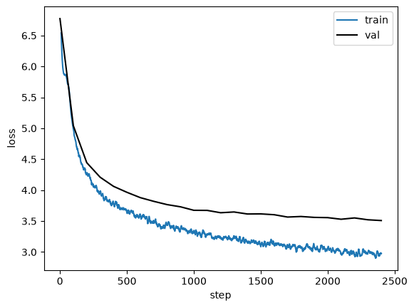
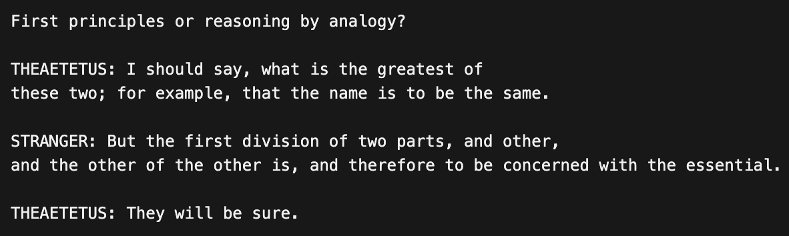

# AttoGPT

---

A Generative Pre-trained Transformer implementation from scratch depending only on NumPy. Developed as a study of the Transformer architecture by direct implementation of its underlying math. The model features the standard components such as LayerNorm, multi-head attention, Adam optimizer. A small instance was trained on a corpus of public-domain English translations of Greek philosophy texts.

## Features

- Byte-pair encoding tokenizer
- (Pre-LN) Transformer block
  - Causal multi-head self-attention
  - Multilayer perceptron
  - LayerNorm
- Manually derived gradients for backpropagation
- Adam optimizer
- Nucleus/top-k sampling

## Project structure

```
attoGPT/
├── src/attogpt/
│   ├── config.py       # Hyperparameters
│   ├── tokenizer.py    # BPE
│   ├── model.py        # Embeddings, attention, MLP, LayerNorm, model class
│   ├── opt.py          # Adam optimizer
│   ├── train.py        # Training loop
│   ├── sample.py       # Top-p/k sampling
│   └── utils.py        # Activations, initialization, loss, data utils
├── notebooks/
│   ├── preprocess.ipynb
│   ├── train.ipynb
│   └── inference.ipynb
└── data/         # Corpus, vocabulary, trained checkpoints
```

## How to run

> [uv](https://docs.astral.sh/uv/)

### Setup

```bash
git clone https://github.com/karlmoresco/attoGPT.git
cd attoGPT
uv sync
```

1. **Train** – run `notebooks/train.ipynb` to save checkpoints to `data/plato/checkpts` (tokenized `plato` corpus ships with the repo)
2. **Sample** – run the cells in `notebooks/inference.ipynb`


*Loss curve (CPU, expected overfit)*

---


*Generated sample from prompt ”First principles or reasoning by analogy?” (noise expected since small model ~1M parameters)*

## References

**Research**
– Vaswani et al., *[Attention Is All You Need](https://arxiv.org/abs/1706.03762)*
– Radford et al., *[Language Models are Unsupervised Multitask Learners](https://cdn.openai.com/better-language-models/language_models_are_unsupervised_multitask_learners.pdf)*
– Xiong et al., *[On Layer Normalization in the Transformer Architecture](https://arxiv.org/abs/2002.04745)*
– He et al., *[Delving Deep into Rectifiers: Surpassing Human-Level Performance on ImageNet Classification](https://arxiv.org/abs/1502.01852)*
– Ba et al., *[Layer Normalization](https://arxiv.org/abs/1607.06450)*
– Kingma & Ba, *[Adam: A Method for Stochastic Optimization](https://arxiv.org/abs/1412.6980)*

**Code**
– [openai/gpt-2](https://github.com/openai/gpt-2)
– [karpathy/nanoGPT](https://github.com/karpathy/nanogpt)

**Data**
– [MIT Internet Classics Archive](https://classics.mit.edu/)
– [Project Gutenberg](https://www.gutenberg.org/)